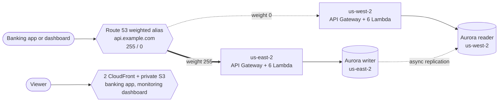

# aws-multi-region-aurora-failover-active-passive

An educational, non-production **active-passive disaster recovery demo** on AWS, in the form of a one-account online bank. A
small serverless API applies deposits and withdrawals to an Aurora PostgreSQL Global Database spread over two regions. Clients always
use one custom domain; Route 53 weighted records decide which region answers. Two static sites use the API: an **online banking app**
and a read-only **DR monitoring dashboard**, each on its own address. Two manual GitHub Actions workflows cut the traffic to a region and
move the service to the other region and back, with a ledger consistency check at the end. You create everything for a few hours, run
the drill, and destroy it.

> **Cost warning.** While it runs the demo costs roughly USD 0.54 per hour, USD 13 per day, USD 390 per month. These
> figures are an **unverified estimate** (see [Cost](#cost)). Destroy it when you are done.
>
> The demo was deployed to one AWS account on 2026-10-14; the Cognito authentication (spec 002) was deployed and checked working
> on 2026-11-10; an automated planned switchover drill was measured there and back on 2026-11-11 (one run, see the
> [DR drill test report](docs/dr-test-report.md)). Read
> [What was and was not verified](#what-was-and-was-not-verified) before relying on any of it.

## What it does

- `POST /transactions` applies a `deposit` or `withdrawal` to the single account (it starts at 0.00, never goes negative) and
  stores the movement with its balance after, the region that processed it and a UTC timestamp.
- `GET /account`, `GET /transactions`, `GET /stats`, `GET /consistency`, `GET /health` read it back. Every method except `GET /health`
  needs a Cognito ID token (`Authorization: Bearer ...`); the `OPTIONS` methods of CORS are open because a browser sends them without it.
- Primary region at creation: `us-east-2` (database, API, Cognito user pool, the two sites). Secondary: `us-west-2` (database, API,
  Cognito replica of the user pool). Global components (the bootstrap stack and the Route 53 records stack `dns`): `us-east-1`.
- Sign-in survives the drill: the user pool is replicated to `us-west-2` and the `failover` workflow activates the replica
  before the switchover ([ADR 0017](docs/adr/0017-cognito-multi-region-replication.md)).
- The drill fences `us-east-2` (reserved concurrency 0, nothing is deleted), runs a **planned switchover** to `us-west-2`, moves the
  Route 53 weights, validates, checks that the ledger is consistent, and fails back. The unplanned (real outage) path is documented too,
  as a manual runbook step.

## Architecture in one picture



More detail, diagrams, the resource inventory and the security summary: [docs/architecture.md](docs/architecture.md). Product
documentation:

| Document | Content |
|---|---|
| [docs/functional.md](docs/functional.md) | What the system does, from a user's point of view |
| [docs/technical.md](docs/technical.md) | Stacks, components, data model, API shapes, configuration, alarms |
| [docs/architecture.md](docs/architecture.md) | Regions, stacks, resource inventory, diagrams, security summary, decisions |
| [docs/dr-runbook.md](docs/dr-runbook.md) | The step-by-step DR and failback drill, with the workflows (Spanish copy: [docs-es/dr-runbook.md](docs-es/dr-runbook.md)) |
| [docs/cost-and-cleanup.md](docs/cost-and-cleanup.md) | Cost estimate, budget alerts, destroy procedure, manual leftovers |
| [docs/adr/](docs/adr/) | Architecture decision records |

## Prerequisites

1. **An AWS account** where you may create IAM roles, Aurora, VPC, API Gateway, CloudFront and Route 53 records. All
   data stays in this one account. Default service quotas are assumed; a brand-new account can have a low Lambda
   concurrency quota, check it.
2. **The account baseline** from the repository `nubesegura-accounts-baseline` (`templates/iam.yaml`, stacks
   `stk-<region code>-baseline-iam-prod`) deployed in both data regions: the GitHub OIDC provider and the API Gateway CloudWatch Logs
   role. They are account-wide and are **not** created by this project ([ADR 0016](docs/adr/0016-organization-github-role-and-account-baseline.md));
   `scripts/deploy.sh` stops with a message if the API Gateway log role is not set.
3. **A Route 53 public hosted zone** for a domain you control, already delegated (the registrar points to the zone's
   name servers). The demo does not create or buy a domain. You need:
   - the hosted zone id (`HOSTED_ZONE_ID`, starts with `Z`);
   - a host name inside that zone for the API (`API_DOMAIN_NAME`, for example `api.example.com`). ACM validates its
     certificates by DNS records written into that zone, so the zone must be public and resolvable.
4. **A GitHub repository** with a GitHub Environment named `prod`, and an IAM role the workflows can assume through OIDC
   (here the organization role `github-actions-terraform-prod-role`, stored as the secret `AWS_ROLE_ARN`).
5. **Owner credentials** (for example SSO administrator) for the one-time setup, for the manual runbook steps (unplanned failover)
   and for the final manual cleanup.
6. **Tools on your workstation** for the scripts and the local checks: AWS CLI v2, `bash` 4+ (Linux, macOS with a newer
   bash, or Git Bash), GNU `date`, `jq`, `curl`. The `deploy` workflow installs its own SAM CLI; locally you also need
   the SAM CLI and the Lambda Python runtime version if you run `scripts/deploy.sh --steps api` yourself.
7. **Aurora PostgreSQL and instance class available for Global Database** in both data regions. The deploy script checks
   this before creating anything (see [ADR 0002](docs/adr/0002-aurora-postgresql-and-instance-class.md)). Manual check:

   ```bash
   aws rds describe-orderable-db-instance-options --region us-east-2 --engine aurora-postgresql \
     --engine-version 16.15 --db-instance-class db.r6g.large \
     --query 'OrderableDBInstanceOptions[?SupportsGlobalDatabases].DBInstanceClass' --output text
   ```

8. **No personal data.** The demo stores only amounts, movement types and times. Enter synthetic values only.

## GitHub Environment `prod`: variables and secrets

Create the Environment under *Settings > Environments > prod*. The workflows read exactly these names and nothing else.
The first step of each workflow fails with a clear message when a required one is missing.

| Name | Kind | Required by | Meaning |
|---|---|---|---|
| `AWS_REGION_PRIMARY` | variable | all four workflows | Region of the primary database and API at creation, for example `us-east-2` |
| `AWS_REGION_SECONDARY` | variable | all four workflows | Region of the secondary database and API at creation, for example `us-west-2` |
| `AWS_REGION_GLOBAL` | variable | all four workflows | Region of the dns and global bootstrap stacks, for example `us-east-1`. Must differ from the two data regions |
| `API_DOMAIN_NAME` | variable | deploy, simulate-outage, failover | Custom domain of the API, a host name inside the hosted zone, for example `api.example.com` |
| `HOSTED_ZONE_ID` | variable | deploy, simulate-outage, failover (destroy: optional, only used to list ACM records) | Route 53 public hosted zone id that contains `API_DOMAIN_NAME` |
| `DB_INSTANCE_CLASS` | variable, optional | deploy | Aurora instance class. Default `db.r6g.large` from `parameters/prod.json`. Never a `db.t*` class |
| `ENGINE_VERSION` | variable, optional | deploy | Aurora PostgreSQL version. Default `16.15` from `parameters/prod.json`. Must support Global Database in both regions |
| `ALERT_EMAIL` | variable, optional | deploy | E-mail subscribed to the alarm topics. Empty means no subscription. AWS sends a confirmation message you must accept |
| `AWS_ROLE_ARN` | **secret** | all four workflows | ARN of the IAM role the workflows assume through GitHub OIDC (the organization role `github-actions-terraform-prod-role`) |

No Cognito password or token is stored in GitHub: the workflows need none. The two demo users are created once by the owner with
`.github/workflows-local/provision-users/provision_users.py` (see below).

Environment protection rules (required reviewers, deployment branches) are owner-side GitHub settings that no file in this repository can
apply. Here the Environment has no required reviewers; the controls are the typed confirmations and the check that the drill workflows
run from `main`.

## One-time setup

Done once, by hand, with owner credentials. Replace the placeholders.

**1. Global bootstrap stack** (CloudFormation execution role, an optional dedicated deploy role, artifact bucket), global region only.
Apply it with a change set and read it before executing:

```bash
aws cloudformation deploy \
  --region us-east-1 \
  --stack-name stk-useast1-drdemo-bootstrap-prod \
  --template-file templates/bootstrap.yaml \
  --capabilities CAPABILITY_NAMED_IAM \
  --no-execute-changeset \
  --tags team-owner=nube-segura project-name=aws-multi-region-aurora-failover-active-passive app-name=dr-demo repo-name=aws-multi-region-aurora-failover-active-passive env-type=prod \
  --parameter-overrides \
    EnvType=prod \
    CreateDeployRole=true \
    GitHubOrg=<github-owner> \
    GitHubRepo=<repository-name> \
    ExistingOidcProviderArn=arn:aws:iam::<account-id>:oidc-provider/token.actions.githubusercontent.com \
    HostedZoneId=<hosted-zone-id> \
    AwsRegionGlobal=us-east-1 \
    AwsRegionPrimary=us-east-2 \
    AwsRegionSecondary=us-west-2
# review the change set in the CloudFormation console or with describe-change-set, then execute it
```

Later updates of this stack keep every current parameter value: create a change set with
`aws cloudformation create-change-set ... --parameters ParameterKey=<name>,UsePreviousValue=true` for each parameter, read
it with `describe-change-set` (it must only modify the resources you expect), then `execute-change-set`.

Notes:

- The stack name must be exactly `stk-useast1-drdemo-bootstrap-prod` (`stk-<global region without dashes>-drdemo-bootstrap-prod`):
  `scripts/deploy.sh` looks it up by that name and passes its output `CfnExecRoleArn` to CloudFormation. If your global region is not
  `us-east-1`, change the region and the name.
- `ExistingOidcProviderArn` is required when `CreateDeployRole=true`; the provider comes from the account baseline.
- The deploy and destroy workflows never touch this stack. The dedicated deploy role it creates (`iamr-useast1-drdemo-deploy-prod`) is not
  used: its GitHub trust uses the old subject format, and the workflows assume the organization role instead
  ([ADR 0016](docs/adr/0016-organization-github-role-and-account-baseline.md)).
- Optional parameter `PermissionsBoundaryArn=<policy arn>` applies a permissions boundary to every role.
- The template is about 48.5 KB, under the 51,200 byte inline limit of `aws cloudformation deploy`. Adding resources to
  `templates/bootstrap.yaml` may need `--s3-bucket`. The workflow-managed bootstrap stacks of the two data regions (artifact bucket only)
  are sent through their own bucket by `scripts/deploy.sh` when a template is larger than the limit.

**2. Demo users** (after the first deploy has created the Cognito stacks): copy
`.github/workflows-local/provision-users/.env.example` to `.env` in the same folder (git-ignored), put your AWS profile, the regions, the
two user e-mails and the two passwords in it, and run:

```bash
python .github/workflows-local/provision-users/provision_users.py
```

It creates `bank-operator` and `dashboard-viewer` in the primary pool in confirmed state (idempotent) and polls the replica region until
they appear there. Details: [.github/workflows-local/README.md](.github/workflows-local/README.md).

## Deploy

Deploy is **manual only** (`workflow_dispatch`); a push never deploys, because the stack costs money while it runs.

1. Define the variables and the secret above in the `prod` Environment.
2. *Actions > deploy > Run workflow* on branch `main`.
3. The workflow validates the configuration, then runs `scripts/deploy.sh` in three groups, with a fresh OIDC login
   before each because the role session lasts one hour:
   1. `--steps bootstrap,edge,cognito,network,db-primary`
   2. `--steps db-secondary`
   3. `--steps schema,api,dns,dashboard`
4. The last step prints one `published: https://<id>.cloudfront.net/` line for each site (the monitoring dashboard and the banking app).

Stack layout, per data region: `bootstrap` (artifact bucket) -> `cognito` (user pool and KMS multi-region key in us-east-2, replica in
us-west-2, deployed in two passes) -> `network` (VPC `10.40.0.0/24` in us-east-2, `10.41.0.0/24` in us-west-2, two
private subnets) -> `database` (KMS key, security groups, Aurora, master secret, alarms) -> `api`; `edge` in us-east-2; global
(`us-east-1`): `bootstrap` (by hand) and `dns`. Details: [docs/technical.md](docs/technical.md#stacks).

The same script runs from a workstation with owner credentials (`bash scripts/deploy.sh --dry-run` prints the plan
without calling AWS). It is safe to repeat. It never redeploys the database stacks once a drill or failover swapped the
roles, and it keeps the current Route 53 weights. Details: [docs/technical.md](docs/technical.md#delivery).

## Use it

### Online banking app and monitoring dashboard

Open the two CloudFront addresses printed by the publish step and sign in on each page (`bank-operator` on the banking app,
`dashboard-viewer` on the dashboard; the tokens are kept in `sessionStorage` of that tab only, never published). In the **banking app** choose deposit or withdrawal, enter an amount and press Execute: it shows the result, the new
balance, the region and backend that answered, the database role, the round-trip and server times, and retries by itself (with one
`Idempotency-Key`) for up to 60 seconds if a region fails. The **monitoring dashboard** is read-only: serving region, database role, balance,
movements per region, the latest 50 movements, a banner and timeline when the region changes, its own poll round trips, and a **Verify** button
for the ledger consistency check. To see the addresses later:

```bash
aws cloudformation describe-stacks --region us-east-2 --stack-name stk-useast2-drdemo-edge-prod \
  --query "Stacks[0].Outputs[?OutputKey=='DistributionDomainName' || OutputKey=='BankDistributionDomainName'].[OutputKey,OutputValue]" --output text
```

### Postman

Import `postman/aws-multi-region-aurora-failover-active-passive.postman_collection.json` and `postman/aws-multi-region-aurora-failover-active-passive.postman_environment.json`. In the
environment set `baseUrl` (`https://api.example.com`, no trailing slash) and `cognito_id_token` (secret; an ID token of a demo user, valid
15 minutes). Folders `01 Health`,
`02 Transactions` (deposit, withdrawal, overdraft, validation, idempotent repeat) and `03 Account, consistency and stats` are functional
checks with tests; `04 DR drill` is the set of requests to run before, during and after the drill. Every response carries `X-Served-By-Region`.

### DR drill

Follow [docs/dr-runbook.md](docs/dr-runbook.md). The short version, with the two workflows (*Actions*, branch `main`):

1. `simulate-outage`: `action` = `fence`, `region` = `us-east-2`, `confirm` = `us-east-2` (reserved concurrency 0 on its six functions).
2. `failover`: `direction` = `to-secondary`, `confirm` = `failover` (activates the Cognito replica, planned switchover, weights 0/255, validation).
3. `failover`: `direction` = `to-primary`, `confirm` = `failover` (unfence, switch back, deactivates the Cognito replica, weights 255/0, validation).

The scripts in `scripts/dr/` do the same steps one by one with **your** owner credentials; they read the regions from
`AWS_REGION_PRIMARY`, `AWS_REGION_SECONDARY` and `AWS_REGION_GLOBAL`, and `40-validate.sh` / `45-consistency.sh` also need `API_DOMAIN_NAME`
and, for the authenticated calls, `COGNITO_ID_TOKEN`. The workflow `failover` holds no token, so run `45-consistency.sh` yourself after it.

## Cost

**Unverified estimate.** It was written before the first deployment, from recalled public list prices (us-east, on-demand) and assumed
usage (below one request per second). No bill has been compared with it yet. Check the AWS Pricing Calculator before you rely on it.

| Period (everything running) | Estimate (USD) |
|---|---|
| Per hour | about 0.54 |
| Per day | about 13.0 (budget with USD 15 as a safe upper bound) |
| Per month (730 h) | about 395 (budget with USD 450 as a safe upper bound) |
| An 8-hour drill | about 4.30 |

Main cost driver: two provisioned Aurora `db.r6g.large` instances, about 97 percent of the total (about USD 380 per
month). Everything else (API Gateway, Lambda, logs, KMS, CloudFront, S3, Route 53 records) is under USD 15 per month.
There is no NAT gateway, VPC endpoint, WAF or load balancer. The hosted zone is assumed to exist (a new zone adds about
USD 0.50 per month). If `db.r5.large` is needed instead, add about USD 44 per month. **The main way to save money is to
run it for hours and destroy it.** Billing data lags by 8 to 24 hours, so the destroy workflow is the real control.
Full breakdown and recommended budget alerts: [docs/cost-and-cleanup.md](docs/cost-and-cleanup.md).

## Destroy everything

1. *Actions > destroy > Run workflow*. Type `destroy-aws-multi-region-aurora-failover-active-passive` in `confirm` and `disable-deletion-protection` in
   `confirm_deletion_protection`. Equivalent locally: `bash scripts/destroy.sh` (add `--dry-run` first to see the plan).
2. The order is: deletion protection off (confirmed), dns, api stacks, Cognito stacks (replica first), detach every global cluster member using the
   **live** roles, database stacks (final snapshots) and then the network stacks, edge (both buckets emptied with all versions), artifact
   buckets and the bootstrap stacks of the two data regions, then a list of leftovers.
3. **Delete by hand afterwards** (details and commands in [docs/cost-and-cleanup.md](docs/cost-and-cleanup.md)):
   - the global bootstrap stack `stk-useast1-drdemo-bootstrap-prod`, with owner credentials (the workflows never touch it);
   - the SSM parameter `/drdemo/prod/api-key` if it still exists from the baseline deployment (nothing uses it any more);
   - final cluster snapshots of both regions;
   - ACM validation CNAME records in your hosted zone, and any CloudWatch log groups still listed;
   - any Aurora cluster you created by hand during the unplanned-failover rebuild;
   - the GitHub Environment variables and secrets, and your budget alerts, if the demo is over.

The account baseline (OIDC provider, API Gateway log role) belongs to another repository and is not removed.

## What was and was not verified

**Deployed and working since 2026-11-10 (spec 002).** The Cognito authentication, the region realignment (Cognito primary and the two sites in
`us-east-2`, replica in `us-west-2`, `bootstrap` and `dns` in `us-east-1`) and the two-pass Cognito deploy reached a healthy state in `prod`
after two deploy runs (the first failed on a Cognito encryption setting and was fixed). **Not yet done after that deployment:** a token
issued through the replica has not been checked against the `us-west-2` authorizer's `iss` in a recorded run, and the owner-side
verification of the confirmation of the alert e-mail subscription is open.

**Cognito-era drill measured (2026-11-11, spec 003; one run, planned path only).** The automated runner (`scripts/e2e`) drove the fence,
`failover` to-secondary and `failover` to-primary on the deployed prod environment. Verdict PASS; write RTO 196.8 s to-secondary and
82.7 s to-primary; measured RPO 0 (504 of 504 movements stored); replication lag at most 933 ms (`AuroraGlobalDBReplicationLag`).
Details, method and limits (negative DNS convergence, secondary sign-in availability 70 % and 43 %, failover probe deposits skipped
because the workflow has no token): [docs/dr-test-report.md](docs/dr-test-report.md) and [runbook](docs/dr-runbook.md#observed-values).
These write RTO values are not comparable with the 195 s total-workflow figure of 2026-10-14 below.

**Baseline deployed and observed (2026-10-14, one AWS account, `prod`; API key era).** All 11 project stacks reached `CREATE_COMPLETE` or `UPDATE_COMPLETE`.
The first deployment attempts needed fixes (engine version, security group prefix, execution role permissions, the certificate request, the
schema bootstrap timing, the lag gate; see the git history), and the final layout was created from scratch after the network split.
A read-only verification of the deployed resources against the templates found
no mismatch that needed an IaC change: network ranges, private subnets without internet gateway, NAT or endpoints, security groups, the
global cluster with writer and secondary, instances `db.r6g.large` on engine `16.15`, customer managed keys, IAM authentication on, Data API
off, 1-day backups, six functions per region (`python3.14`, arm64), roles `iamr-*`, API key required on every method except `OPTIONS`, usage
plan (all replaced by Cognito in spec 002), custom domain and certificates, weighted records 255/0, private buckets behind CloudFront with the CSP, 14 alarms in OK, no error lines
in two hours, mandatory tags. The unauthenticated `GET /health` answered `403` and both sites answered `200`.

**Drill observed on 2026-10-14 (history, API key era).** A planned drill there and back: fence 41 s; `failover` to-secondary 195 s (switchover 36 s, DNS change about 70 s);
to-primary 170 s (switchover 35 s); writes unavailable about 35 to 40 s per switchover; ledger consistent after both
([runbook](docs/dr-runbook.md#observed-values-2026-10-14-history); values from the workflow runs, one run each). These are total workflow
durations; the current measurement is the 2026-11-11 drill above.

**Checked offline** (CI runs these commands, except `sam build`; last recorded results are from 2026-10-13, before the network stack split,
and this documentation stage did not re-run them):

- Backend: `ruff check`, `ruff format --check`, `mypy --strict`, `import-linter`, and 287 `pytest` tests with fakes and fake database
  connections, 99 percent coverage (CI gate: 85 percent).
- Both sites: `node --test` and a JavaScript syntax check; both were also exercised against a local mock API (`scripts/dashboard-mock.mjs`).
- Templates: `cfn-lint`, `sam validate --lint`, `checkov` (139 passed, 0 failed, 37 skipped, each skip justified in the template; 373 passed,
  0 failed, 3 skipped on the workflows) and a grep that forbids internet gateways, NAT and endpoints.
- Scripts: `shellcheck`, `bash -n`, `--dry-run` of every script, stub tests of the consistency, publish, Cognito deploy and lag-gate scripts.
- Workflows: `actionlint`. Postman and JSON files: syntax only.
- This documentation: names, endpoints, parameters, variables, secrets, scripts and flags it mentions were checked by `grep`
  against the code, templates, scripts and workflows when it was written.

**Not verified** (needs a real run):

- The unplanned failover (`--allow-data-loss`), the measurement of the data gap and the manual rebuild of a secondary in `us-east-2`
  (written from the AWS documentation, never run).
- The destroy procedure on the deployed account (spec task A4.8 is open) and what is left behind.
- Deletion protection: `parameters/prod.json` says `true` (restored by commit `9c40f1b`); what the deployed clusters show now was not
  re-read for this document.
- CloudFormation drift of the database stacks after the drill ([ADR 0005](docs/adr/0005-database-stacks-not-redeployed-during-drills.md) says it is
  expected and harmless; drift detection was not run), the permissions of the organization role beyond what the runs used, and the package
  contents of the Lambda functions.
- The cost figures, the "RPO about one second" figure of the unplanned path (a typical value, not a guarantee), the 15-minute RTO as a
  guarantee (it was measured once, on 2026-11-11, planned path only), and the time resolvers and keep-alive connections take to follow a
  weight change.
- That CloudTrail and budget alerts exist in the account (assumed, outside this project).

Accepted risks of a demo (recorded in [docs/adr/](docs/adr/)): local Cognito users without MFA or federation as the only credential, no WAF, one instance per
cluster (not highly available inside a region), one-day backups, default CloudFront certificate, no Lambda reserved
concurrency in the template ([ADR 0012](docs/adr/0012-no-lambda-reserved-concurrency-in-template.md)).

## Known limitations

- Replaying an `Idempotency-Key` with a different payload returns the original result (`200`) and ignores the new payload;
  there is no conflict error.
- The workflows run only a planned switchover. `scripts/dr/20-promote.sh --unplanned` asks for the typed phrase `allow-data-loss <region>`
  only on an interactive terminal; it cannot be passed as a flag or run from a non-interactive job.
- `scripts/dr/10-simulate-outage.sh` is named for the drill but is also the **fence** that protects against split brain
  after an unplanned failover (same mechanism, reserved concurrency 0).
- `deploy`, `destroy`, `simulate-outage` and `failover` share one concurrency group; GitHub keeps one pending run per group, so check the run
  list after dispatching (a pending run can silently replace another).
- The global bootstrap stack `stk-useast1-drdemo-bootstrap-prod` is created and deleted by hand; the workflows never touch it.
- The API Gateway `OPTIONS` methods (CORS preflight), `GET /health` and the gateway's own error responses need no token; the gateway errors and preflight answer
  `Access-Control-Allow-Origin: *`; the functions echo only the two site origins.
- The scripts fix the environment to `prod`; the templates also accept `dev` ([ADR 0011](docs/adr/0011-single-environment-trunk-on-main.md)).
- There is one instance per cluster: no reader replica inside a region (a possible later feature).

## Repository layout

```
templates/            bootstrap, cognito, network, edge, database, api, dns (one SAM/CloudFormation template per stack)
parameters/prod.json  the only file with environment-specific values
samconfig.toml        sam build and deploy settings for the api template (and sam validate for the database template)
src/backend/          hexagonal Python package, Lambda handlers, tests
src/bank/             online banking app (static, no build step)
src/dashboard/        read-only monitoring dashboard (static, no build step)
scripts/              deploy.sh, destroy.sh, init-schema.sh, publish-*.sh, dr/ (drill), lib/, sql/, tests/
postman/              collection and environment
.github/workflows-local/  local runners of the workflows; provision-users/ creates the demo users
docs/ docs-es/        product documentation (English first; Spanish runbook copy)
.github/workflows/    ci.yml, deploy.yml, destroy.yml, simulate-outage.yml, failover.yml
```

Local checks (the same commands as CI) are listed in [src/backend/README.md](src/backend/README.md). Branching is
trunk-based on `main`; there is a single environment, `prod`.
