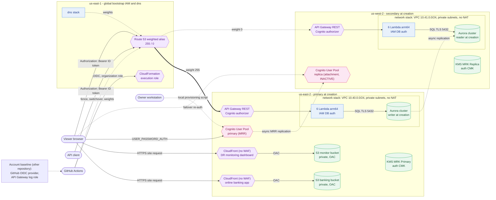
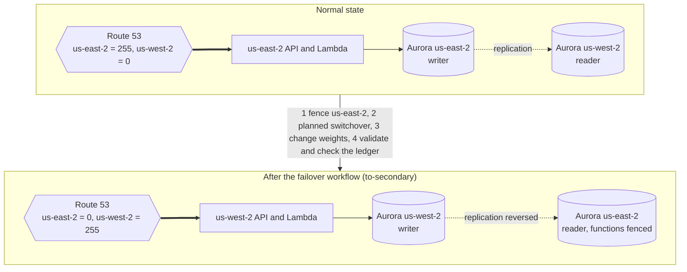

# Architecture

Active-passive disaster-recovery demo on AWS, in the form of a one-account online bank. A serverless API stores deposits and
withdrawals in an Aurora Global Database; clients always use one custom domain and Route 53 weighted records decide which
region answers. Two static sites use the API: an online banking app and a read-only DR monitoring dashboard, each on its own
CloudFront address. This is a non-production, educational project meant to be created for a few hours and destroyed.

Status: baseline spec 001 deployed on 2026-10-14; spec `002-multi-region-cognito` (Cognito Multi-Region Replication replacing the
API key, with the 2026-11-10 region realignment) deployed and working in `prod` on 2026-11-10, in a single AWS account.
Diagrams: AWS components [architecture.drawio](architecture.drawio) / [png](architecture.png) and layers
[architecture-layers.drawio](architecture-layers.drawio) / [png](architecture-layers.png). What changes in which resource during
the three demo workflows: [dr-outage-flow.drawio](dr-outage-flow.drawio) / [png](dr-outage-flow.png) (`demo-1-outage`),
[dr-failover-flow.drawio](dr-failover-flow.drawio) / [png](dr-failover-flow.png) (`demo-2-failover`, to-secondary) and
[dr-failback-flow.drawio](dr-failback-flow.drawio) / [png](dr-failback-flow.png) (`demo-3-failback`, to-primary). Animated walkthrough of the drill (normal flow, simulated outage, failover), open in a
browser: [dr-flow-animation.html](dr-flow-animation.html). Spanish copy of the runbook:
[../docs-es/dr-runbook.md](../docs-es/dr-runbook.md) (English is the source).
Related: [functional.md](functional.md), [technical.md](technical.md), [dr-runbook.md](dr-runbook.md),
[cost-and-cleanup.md](cost-and-cleanup.md), [adr/](adr/README.md).

## Regions

| Region | Role | What runs there |
|---|---|---|
| us-east-1 | Global bootstrap IAM and `dns` | Global bootstrap stack (`stk-useast1-drdemo-bootstrap-prod`: CloudFormation execution role, deploy role, global artifact bucket); Route 53 weighted records stack (`dns`, `stk-useast1-drdemo-dns-prod`) |
| us-east-2 | Primary at creation | VPC (`10.40.0.0/24`), Aurora primary cluster, global cluster resource, API Gateway, six Lambda functions, Cognito primary User Pool (`cgnp-useast2-drdemo-prod`), primary KMS Multi-Region Key, Cognito App Clients, `UserPoolReplica` declaration, edge static buckets and CloudFront distributions (`edge`) |
| us-west-2 | Secondary at creation | VPC (`10.41.0.0/24`), Aurora secondary cluster, API Gateway, six Lambda functions (identical code), Cognito replica KMS key (`AWS::KMS::ReplicaKey`) and regional configuration attachment (`Status: INACTIVE` at rest) |

`us-east-1` (`AWS_REGION_GLOBAL`) holds the global bootstrap stack because IAM roles are global and moving the stack is
cosmetic and high-risk while existing regional stacks reference `iamr-useast1-drdemo-cfnexec-prod` (deferred to
the project backlog). Co-locating Cognito primary and `edge` in `us-east-2` aligns active workloads in one region.
The `dns` stack stays in `us-east-1` (`stk-useast1-drdemo-dns-prod`, owner decision): the weight switch of
`30-switch-traffic.sh` and `failover.yml` is a CloudFormation update that must keep working while `us-east-2` is down, which
preserves [ADR 0003](adr/0003-manual-weighted-routing.md) DR isolation. It costs nothing extra next to `bootstrap`.

Database roles swap at runtime (RDS does it, not CloudFormation), so no physical resource name contains "primary" or "writer".

## Stacks

Stack names follow `stk-<region without dashes>-drdemo-<stack>-prod`. Account-wide resources are **not** part of this project
([ADR 0016](adr/0016-organization-github-role-and-account-baseline.md)): the GitHub OIDC provider and the API Gateway
CloudWatch Logs role and account setting of each data region come from the repository `nubesegura-accounts-baseline`
(`templates/iam.yaml`, stacks `stk-<region code>-baseline-iam-prod`).

| Stack (template) | Region | Contents |
|---|---|---|
| `bootstrap` (global) | us-east-1, **by hand once, with a change set**; never touched by the deploy or destroy workflows | Global artifact bucket, CloudFormation execution role (`iamr-useast1-drdemo-cfnexec-prod`) and its policies, dedicated deploy role (created but not used, see ADR 0016) |
| `bootstrap` (data) | us-east-2 and us-west-2, by the deploy workflow | Artifact bucket only |
| `cognito` | us-east-2 (primary) and us-west-2 (replica) | Customer managed KMS Multi-Region Key (primary in us-east-2, replica in us-west-2), Cognito User Pool (primary declaring replica MRR, replica declaring regional attachment), App Clients (shared across regions, no secret, 15m tokens) |
| `network` | us-east-2 and us-west-2 | VPC, two private subnets (one per AZ), two route tables; no internet gateway, NAT, endpoints or peering |
| `database` | us-east-2 (`Role=primary`) and us-west-2 (`Role=secondary`) | KMS key, security groups, subnet group, cluster parameter group, global cluster and master secret (primary only), Aurora cluster with one instance, log group, SNS topic, alarms |
| `api` | both data regions | REST API, Cognito Authorizer (replaces API key & usage plan), six Lambda functions with one role each, log groups, regional custom domain with ACM certificate, base path mapping, alarms; no WAF |
| `edge` | us-east-2 | Two private S3 buckets, two CloudFront distributions (`*.cloudfront.net` default certificates) with one origin access control and one security-headers policy; no WAF (accepted risk) |
| `dns` | us-east-1 (`AWS_REGION_GLOBAL`) | Two Route 53 weighted alias records (weights 255/0) |

Stacks exchange values only through parameters (no CloudFormation exports), so each can be deleted on its own.
Deployment topology note: Cognito primary is co-located in `us-east-2` alongside primary compute and data. Per AWS
verification, the replica shares the exact same User Pool ID and App Client IDs as the primary (no separate `cgnc-uswest2-*`
clients exist); only the User Pool ARN differs per region (`us-east-2` vs `us-west-2`, retaining regional `iss` without
`IssuerConfiguration` override). Therefore, `templates/api.yaml` in each data region consumes local regional SSM parameters
(`/drdemo/prod/cognito/UserPoolArn`, `BankClientId`, `DashboardClientId`) from its own region (`us-east-2` and `us-west-2`).

Deploy order (`scripts/deploy.sh`; the workflow runs it in three groups with a fresh OIDC login before each):

| Group | Steps |
|---|---|
| 1 | `bootstrap` (data regions), `edge` (`us-east-2`) & `network` (both regions), `cognito` two-pass MRR (`us-east-2` `EnableReplica=false` -> `us-west-2` `ReplicaKmsKey` -> `us-east-2` `EnableReplica=true` `UserPoolReplica` -> `us-west-2` `UserPoolRegionalConfigurationAttachment` -> `us-east-2` `UserPoolDeletionProtection=ACTIVE`), `db-primary` |
| 2 | `db-secondary` |
| 3 | `schema` (Data API on, SQL, Data API off), `api` (both regions), `dns`, `dashboard` (publishes both sites) |

The global bootstrap stack in `us-east-1` must exist before group 1 (the script stops with a message if it does not). The
database stacks are not redeployed during a DR drill ([ADR 0005](adr/0005-database-stacks-not-redeployed-during-drills.md));
the network stacks are independent of the database roles and can be updated at any time.

## Resource inventory

`<rc>` is the region code without dashes (`useast2`, `uswest2`, `useast1`). Environment: only `prod` exists. Every taggable
resource carries `team-owner`, `project-name`, `app-name`, `repo-name` and `env-type`; data stores also carry the `sec-*` tags.

### Network (per data region)

| Resource | IaC type | Name (prod) | Purpose |
|---|---|---|---|
| VPC | `AWS::EC2::VPC` | `vpc-<rc>-drdemo-prod` | `10.40.0.0/24` in us-east-2, `10.41.0.0/24` in us-west-2 |
| Subnets | `AWS::EC2::Subnet` x2 | `snet-<rc>-drdemo-az1-prod`, `snet-<rc>-drdemo-az2-prod` | Private, one per AZ (/25 each), no public IP |
| Route tables | `AWS::EC2::RouteTable` x2 and associations | `rtb-<rc>-drdemo-az1-prod`, `rtb-<rc>-drdemo-az2-prod` | Local route only |

### Database (per data region)

| Resource | IaC type | Name (prod) | Purpose |
|---|---|---|---|
| KMS key and alias | `AWS::KMS::Key`, `AWS::KMS::Alias` | `alias/kms-<rc>-drdemo-data-prod` | Customer managed key (rotation on): Aurora storage, secret, logs, SNS |
| Security groups | `AWS::EC2::SecurityGroup` x2 | `sgp-<rc>-drdemo-lambda-prod`, `sgp-<rc>-drdemo-db-prod` | Lambda reaches only the database on 5432; the database accepts only the Lambda group |
| Subnet group | `AWS::RDS::DBSubnetGroup` | `dbsg-<rc>-drdemo-prod` | The two private subnets |
| Cluster parameter group | `AWS::RDS::DBClusterParameterGroup` | `dbpg-<rc>-drdemo-cluster-prod` | `rds.force_ssl=1` |
| Global cluster (us-east-2 stack only) | `AWS::RDS::GlobalCluster` | `rdsg-useast2-drdemo-prod` | Aurora PostgreSQL 16.15, encrypted; `DeletionProtection` from the parameter |
| Aurora cluster | `AWS::RDS::DBCluster` | `rdsc-<rc>-drdemo-prod` | Encrypted, IAM authentication on, 1-day backups, `DeletionPolicy: Snapshot`, deletion protection from the parameter, `postgresql` log export |
| Aurora instance | `AWS::RDS::DBInstance` | `rds-<rc>-drdemo-prod` | One `db.r6g.large` per cluster, not public, no Multi-AZ |
| Master secret (us-east-2 stack only) | `AWS::SecretsManager::Secret` | `sm-useast2-drdemo-master-prod-<suffix>` | Generated master password, read only by the schema bootstrap |
| Log group | `AWS::Logs::LogGroup` | `/aws/rds/cluster/rdsc-<rc>-drdemo-prod/postgresql` | 30 days, KMS |
| SNS topic and policy | `AWS::SNS::Topic`, `AWS::SNS::TopicPolicy` | `sns-<rc>-drdemo-alerts-prod` | Alarm notifications (e-mail subscription only if `ALERT_EMAIL` is set) |
| Alarms | `AWS::CloudWatch::Alarm` x3 | `alrm-<rc>-drdemo-replication-lag-prod`, `alrm-<rc>-drdemo-db-cpu-prod`, `alrm-<rc>-drdemo-db-connections-prod` | Replication lag, CPU, connections |
| Database objects | SQL in `scripts/sql/schema.sql` | tables `account` (one row) and `transactions` (ledger), users `app_writer`, `app_reader` | Applied once through the Data API |

### Cognito Identity (Multi-Region Replication)

Modular template `templates/cognito.yaml` deployed in two passes across `us-east-2` (primary) and `us-west-2` (replica),
establishing an active-standby multi-region user directory with customer-managed AWS KMS Multi-Region encryption (spec 002).
Per AWS verification, the replica shares the same User Pool ID (`cgnp-useast2-drdemo-prod`) and the same App Client IDs
(`cgnc-useast2-drdemo-bank-prod`, `cgnc-useast2-drdemo-dash-prod`); no separate replica clients (`cgnc-uswest2-*`) exist. Only
the User Pool ARN differs by region (`us-east-2` vs `us-west-2`). Pass 1 creates `PrimaryKmsKey` + `UserPool` + `AppClients`
(`us-east-2`) and `ReplicaKmsKey` (`us-west-2`, before replication); Pass 2 enables `UserPoolReplica` (`us-east-2`) and
`UserPoolRegionalConfigurationAttachment` (`us-west-2`, initial `Status: INACTIVE`), followed by setting
`UserPoolDeletionProtection: ACTIVE` (`COG-04`) in steady-state `prod`.

| Resource | IaC type | Name (prod) | Purpose |
|---|---|---|---|
| Primary User Pool (us-east-2) | `AWS::Cognito::UserPool` | `cgnp-useast2-drdemo-prod` | Primary user directory (`ESSENTIALS` tier, `DeletionProtection` parameterized: `INACTIVE` during initial create/teardown and `ACTIVE` post-create for `COG-04`, `USER_PASSWORD_AUTH` enabled, `AllowAdminCreateUserOnly: true`, min 12-char complex password policy) |
| KMS Multi-Region Key (primary, us-east-2) | `AWS::KMS::Key`, `AWS::KMS::Alias` | `alias/kms-useast2-drdemo-cognito-prod` | Customer managed multi-region primary key encrypting user credential hashes for MRR replication |
| App Clients (us-east-2, shared across regions) | `AWS::Cognito::UserPoolClient` x2 | `cgnc-useast2-drdemo-bank-prod`, `cgnc-useast2-drdemo-dash-prod` | Public SPA clients (no client secret), `ALLOW_USER_PASSWORD_AUTH` and `ALLOW_REFRESH_TOKEN_AUTH`, token validity: ID 15m, Access 15m, Refresh 24h; shared by primary and replica |
| User Pool Replica declaration (us-east-2) | `AWS::Cognito::UserPoolReplica` | Declared in primary stack (Pass 2, `EnableReplica=true`) | Replicates primary pool asynchronously to us-west-2 via AWS MRR after `ReplicaKmsKey` exists |
| KMS Multi-Region Key (replica, us-west-2) | `AWS::KMS::ReplicaKey`, `AWS::KMS::Alias` | `alias/kms-uswest2-drdemo-cognito-prod` | Customer managed multi-region replica key in us-west-2 created in Pass 1 before `UserPoolReplica` |
| Regional Configuration Attachment (us-west-2) | `AWS::Cognito::UserPoolRegionalConfigurationAttachment` | Attached to replica pool (Pass 2) | Manages replica settings in us-west-2 with initial `Status: INACTIVE` (activated during failover drill) |
| Cognito SSM parameters (us-east-2 and us-west-2) | `AWS::SSM::Parameter` String x4 per region | `/drdemo/prod/cognito/UserPoolId`, `UserPoolArn`, `BankClientId`, `DashboardClientId` | Regional Cognito outputs consumed by `templates/api.yaml` and publish scripts |

### API (per data region)

| Resource | IaC type | Name (prod) | Purpose |
|---|---|---|---|
| Lambda functions x6 | `AWS::Serverless::Function` | `fnc-<rc>-drdemo-create-transaction-prod`, `...-list-transactions-prod`, `...-get-stats-prod`, `...-get-health-prod`, `...-get-account-prod`, `...-get-consistency-prod` | python3.14, arm64, 256 MB, 20 s, in the private subnets; `create-transaction` is the only writer; reads claims from `requestContext.authorizer.claims` and validates `aud` (client ID) and `token_use == 'id'` (defense-in-depth) |
| Execution roles x6 | `AWS::IAM::Role` | `iamr-<rc>-drdemo-<function>-prod` | One per function; `rds-db:connect` on its own database user only |
| Log groups x6 | `AWS::Logs::LogGroup` | `/aws/lambda/fnc-<rc>-drdemo-<function>-prod` | JSON logs, 30 days, KMS |
| REST API and stage | `AWS::Serverless::Api` | `apig-<rc>-drdemo-prod`, stage `prod` | Regional, default endpoint disabled, throttling 20/40, error-level execution logs, access log group (logs `sub`, `username`, `authorizerLatency`), no WAF |
| Cognito Authorizer | `AWS::ApiGateway::Authorizer` | `apiga-<rc>-drdemo-cognito-prod` | Native Cognito Authorizer (type `COGNITO_USER_POOLS`, `apiga-useast2-drdemo-cognito-prod` and `apiga-uswest2-drdemo-cognito-prod`) validating Bearer ID Tokens on protected routes and injecting claims into `requestContext.authorizer.claims` |
| Certificate, domain, mapping | `AWS::CertificateManager::Certificate`, `AWS::ApiGateway::DomainName`, `AWS::ApiGateway::BasePathMapping` | custom API domain (TLS 1.2, regional) | DNS-validated certificate; mapping without prefix |
| Alarms x5 | `AWS::CloudWatch::Alarm` | `alrm-<rc>-drdemo-api-4xx-prod`, `alrm-<rc>-drdemo-api-5xx-prod`, `...-lambda-errors-prod`, `...-lambda-throttles-prod`, `...-cert-expiry-prod` | Authorizer/4XX spikes (>25 in 5m), 5XX, Lambda errors and throttles (6 functions), cert expiry |
| Routes | events of the REST API | `POST /transactions`, `GET /transactions`, `GET /stats`, `GET /health`, `GET /account`, `GET /consistency` | Protected routes require `Authorization: Bearer <id_token>`; `GET /health` and `OPTIONS` (CORS preflight) need no token |

### Edge (us-east-2) and DNS (us-east-1)

| Resource | IaC type | Name (prod) | Purpose |
|---|---|---|---|
| Dashboard bucket and policy | `AWS::S3::Bucket`, `AWS::S3::BucketPolicy` | `bckt-useast2-drdemo-dashboard-<account-id>-prod` | Monitoring site in `us-east-2`; private, versioned, SSE-S3, TLS only, read only for its distribution through OAC |
| Banking app bucket and policy | `AWS::S3::Bucket`, `AWS::S3::BucketPolicy` | `bckt-useast2-drdemo-bank-<account-id>-prod` | Online banking site in `us-east-2`; same settings |
| Origin access control | `AWS::CloudFront::OriginAccessControl` | `oac-useast2-drdemo-dashboard-prod` | Shared by both distributions |
| Security headers policy | `AWS::CloudFront::ResponseHeadersPolicy` | `rhp-useast2-drdemo-dashboard-prod` | CSP (`connect-src 'self'`, API domain, and Cognito endpoints in `us-east-2` and `us-west-2`), HSTS, frame and referrer headers; shared |
| Distributions | `AWS::CloudFront::Distribution` x2 | `cfd-useast2-drdemo-dashboard-prod`, `cfd-useast2-drdemo-bank-prod` | Default `*.cloudfront.net` domains, no WAF (accepted risk); the two addresses are the CORS allow-list of the API |
| Weighted records (`dns`) | `AWS::Route53::RecordSet` x2 | set identifiers `use2` and `usw2` (stack `stk-useast1-drdemo-dns-prod` in `us-east-1`) | Alias to the regional API domains, weights 255/0, TTL 60 s |

### Bootstrap (us-east-1 global IAM + per-data-region artifact buckets)

| Resource | IaC type | Name (prod) | Purpose |
|---|---|---|---|
| Artifact bucket | `AWS::S3::Bucket` (bootstrap, `us-east-1`, `us-east-2`, `us-west-2`) | `bckt-<rc>-drdemo-artifacts-<account-id>-prod` | SAM packages and large templates |
| Execution role and policies | `AWS::IAM::Role`, `AWS::IAM::ManagedPolicy` x4 (global bootstrap, `us-east-1`) | `iamr-useast1-drdemo-cfnexec-prod`, `iamp-useast1-drdemo-cfnexec-data-prod`, `...-security-prod`, `...-app-prod`, `...-edge-prod` | The role CloudFormation uses across regions |
| Dedicated deploy role and policy (not used) | `AWS::IAM::Role`, `AWS::IAM::ManagedPolicy` (global bootstrap, `us-east-1`) | `iamr-useast1-drdemo-deploy-prod`, `iamp-useast1-drdemo-deploy-prod` | Created with `CreateDeployRole=true`; workflows use the organization role instead |

### Workflows and scripts (no AWS resource)

| Item | Path | Purpose |
|---|---|---|
| Workflows | `.github/workflows/ci.yml`, `deploy.yml`, `destroy.yml`, `simulate-outage.yml`, `failover.yml` | CI on every push; the other four are manual from `main` and share the concurrency group `drdemo-prod-infrastructure` |
| Local workflow runners & provisioning | `.github/workflows-local/{deploy,destroy,simulate-outage,failover}.sh`, `.github/workflows-local/provision-users/provision_users.py` (with `tests/` and `.env.example`) | Local runners using `AWS_PROFILE`; automated local script provisioning `bank-operator` and `dashboard-viewer` in confirmed status with `us-east-2` -> `us-west-2` replication verification |
| Scripts | `scripts/deploy.sh`, `destroy.sh`, `init-schema.sh`, `publish-dashboard.sh`, `publish-bank.sh`, `fetch-rds-ca.sh`, `scripts/dr/*.sh`, `scripts/lib/*.sh` | Delivery and the drill |

## Architecture view



## Data flow of one movement

```mermaid
sequenceDiagram
    participant B as Banking app
    participant C as Cognito (primary/replica)
    participant R as Route 53
    participant A as API Gateway (serving region)
    participant L as Lambda in VPC
    participant D as Aurora cluster endpoint
    B->>C: InitiateAuth (USER_PASSWORD_AUTH)
    C-->>B: Bearer ID Token + Refresh Token (15m validity)
    B->>R: resolve api domain (weighted, alias)
    R-->>B: regional API address (weight 255 region)
    B->>A: POST /transactions with Bearer ID Token and Idempotency-Key
    A->>A: validate token signature & claims via Cognito Authorizer
    A->>L: invoke with claims in requestContext.authorizer.claims
    L->>L: validate input, extract user claims, create IAM DB token locally
    L->>D: BEGIN, lock account row, insert movement, update balance, COMMIT (TLS, app_writer)
    D-->>L: stored movement and balance, or read-only error
    L-->>A: 201 / 200 replay, 422, 503 database_read_only or database_busy
    A-->>B: response with X-Served-By-Region and server time
    B->>B: on network error, 429 or 5xx retry with the same key for up to 60 s; background refresh token before 15m expire
```

## Normal state and after failover



Order matters: automatic DNS failover would send writes to a region whose database is still read-only, so
the traffic switch follows the database promotion and is manual (a workflow). The workflows run only a **planned switchover**: no
data is lost ([ADR 0015](adr/0015-planned-switchover-only.md)). `failover-global-cluster --allow-data-loss` (real outage) can
lose about one second of writes and detaches the old primary, which may still accept writes (split brain) unless its functions are
fenced (reserved concurrency 0); it stays a manual runbook step.

## Security design summary

- Aurora is private (no IGW, NAT or endpoints), encrypted with a customer managed key per region, TLS forced and
  verified; the functions authenticate with IAM database authentication and two least-privilege database users.
  The master password is a generated Secrets Manager secret in the primary region (RDS cannot manage it for a global
  database), used only by the schema bootstrap; the Data API is on only for that step.
- API Gateway protected routes require a Cognito Bearer ID Token validated by regional Cognito Authorizers (`us-east-2` primary
  User Pool, `us-west-2` replica User Pool under customer-managed KMS Multi-Region Keys; public `GET /health` and `OPTIONS`
  preflight excluded). Backend Lambdas enforce defense-in-depth checks on `aud` and `token_use == 'id'` from
  `requestContext.authorizer.claims`. `UserPoolDeletionProtection` starts `INACTIVE` during initial stack/replica creation
  and is set to `ACTIVE` post-create (`COG-04`) for steady-state `prod`. Stage throttling caps burst/rate (20/40 rps), the
  default execute-api endpoint is disabled, and access logs record `sub` and `username` without tokens or bodies. CORS echoes
  only the two CloudFront origins; static preflight and gateway error responses answer `*`.
- Both sites: private bucket in `us-east-2`, CloudFront OAC, CSP without inline code and with `connect-src 'self'`, the API
  domain, and the regional Cognito endpoints (`us-east-2`, `us-west-2`), plus HSTS. The monitoring dashboard never writes.
  **No AWS WAF (accepted risk, 2026-11-10):** neither the CloudFront distributions nor the API Gateway stages attach a WAF WebACL
  ("No crear WAF por ahora"; future options recorded in the project backlog: regional WAFv2 on API Gateway in
  `us-east-2`/`us-west-2` and/or `CLOUDFRONT` scope WAFv2 in `us-east-1`).
- Deployment: GitHub OIDC with the organization role `github-actions-terraform-prod-role` (secret `AWS_ROLE_ARN`), manual workflows
  only from `main`, typed confirmations for destroy, fence and failover, and the CloudFormation execution role
  `iamr-useast1-drdemo-cfnexec-prod` (in `us-east-1`, with `D17` region-scoped `kms` wildcard exception) separate from the role
  GitHub assumes. Account-wide resources come from the account baseline repository.
- Accepted deviations from the team standard, all for cost or demo simplicity: IAM database authentication, local Cognito users
  without federated IdP (`AllowAdminCreateUserOnly: true`), **no AWS WAF on CloudFront or API Gateway (accepted 2026-11-10)**,
  **global `bootstrap` stack kept in `us-east-1` ([ADR 0018](adr/0018-region-realignment.md))**, `D17` (`kms:ListAliases`/`CreateKey`/`ReplicateKey`
  `Resource: "*"` scoped by region), no NAT or VPC endpoints, one instance per cluster (no reader replica, no Multi-AZ), 1-day
  backups, default CloudFront certificate (TLS floor of the default certificate; HTTP is redirected, not refused), no VPC flow
  logs, 30-day log retention, no X-Ray, no Lambda DLQ (synchronous functions only), no reserved concurrency in the template (the
  drill sets it; [ADR 0012](adr/0012-no-lambda-reserved-concurrency-in-template.md)), CloudFormation termination protection off.
  They are explained in the ADRs and in the comments of the templates.

## Decisions

Recorded in [docs/adr/](adr/README.md):

| ADR | Decision |
|---|---|
| [0001](adr/0001-aws-sam.md) | AWS SAM with one template per stack; parameters instead of exports |
| [0002](adr/0002-aurora-postgresql-and-instance-class.md) | Aurora PostgreSQL 16.15, provisioned, `db.r6g.large` (burstable classes are unsupported by Global Database) |
| [0003](adr/0003-manual-weighted-routing.md) | Manual weighted DNS (255/0) instead of health-check failover (the `dns` stack stays in `us-east-1`) |
| [0004](adr/0004-api-key-only-accepted-risk.md) | API key (SSM SecureString) and usage plan only, no authorizer (**superseded by spec 002**: Cognito Bearer ID tokens) |
| [0005](adr/0005-database-stacks-not-redeployed-during-drills.md) | Database roles swap outside CloudFormation; database stacks are not redeployed during or after a drill (drift) |
| [0006](adr/0006-manual-deploy-only.md) | Deploy, destroy, simulate-outage and failover are manual workflows only |
| [0007](adr/0007-schema-bootstrap-via-data-api.md) | Schema bootstrap through the RDS Data API, then disabled |
| [0008](adr/0008-outage-simulation-method.md) | Outage simulation with reserved concurrency 0 (also the fence against split brain) |
| [0009](adr/0009-iam-database-authentication.md) | IAM database authentication despite the team default; no password in the functions |
| [0010](adr/0010-two-database-users.md) | Two least-privilege database users, writer and reader |
| [0011](adr/0011-single-environment-trunk-on-main.md) | One environment (`prod`), trunk-based on `main` |
| [0012](adr/0012-no-lambda-reserved-concurrency-in-template.md) | No Lambda reserved concurrency in the template; mitigations instead |
| [0013](adr/0013-connection-discard-and-single-retry.md) | Discard a failed connection, retry once, fresh connection for the database role |
| [0014](adr/0014-ledger-row-lock.md) | Ledger movements serialized with a row lock on the single account row |
| [0015](adr/0015-planned-switchover-only.md) | Workflows run a planned switchover only; unplanned failover stays manual |
| [0016](adr/0016-organization-github-role-and-account-baseline.md) | Organization GitHub role reused; account-wide resources in the account baseline repository |

Also part of the design, without a separate ADR: no NAT and no VPC endpoints (functions never call AWS APIs from the VPC), a network
stack apart from the database stack, global bootstrap in `us-east-1` with primary workloads (`cognito`, `edge`, `network`,
`database`, `api`) aligned in `us-east-2` (`dns` stays in `us-east-1`), default CloudFront domains for the two sites without
WAF, and deletion protection plus a confirmed destroy step with final snapshots (see [technical.md](technical.md)).

## Cost summary

**Unverified estimates** from FinOps reviews written before deployment (public list prices recalled/queried, usage assumed);
no bill has been compared with them yet. The Cognito and KMS delta was re-checked in a FinOps pre-deploy review on 2026-11-10 (about 395.2 per month in total); still no bill compared.
Detail, drivers and budget alerts: [cost-and-cleanup.md](cost-and-cleanup.md).

| Item | Estimate (USD per month, 730 h) |
|---|---|
| Aurora: 2 x provisioned `db.r6g.large` instances | about 379.60 |
| KMS keys (4: 2 database CMKs + 2 Cognito MRK CMKs) and the master secret | about 4.40 |
| CloudWatch alarm metrics (36 total across `api` and `database` in both regions) | about 3.60 |
| Aurora storage, I/O and cross-region replicated I/O | about 5.00 |
| API Gateway, Lambda, logs (both regions) | about 2.70 |
| Cognito Essentials + MRR (2 demo MAUs), CloudFront, S3, Route 53 records, bootstrap, dns (no WAF) | about 0.07 |
| **Total** | **about 395.4 (hour about 0.54, day about 13.0)** |

The requirement keeps about USD 15 per day (about USD 450 per month) as the safe upper bound. The demo is meant to be
destroyed after use; the Aurora instances are about 96 percent of the cost.
